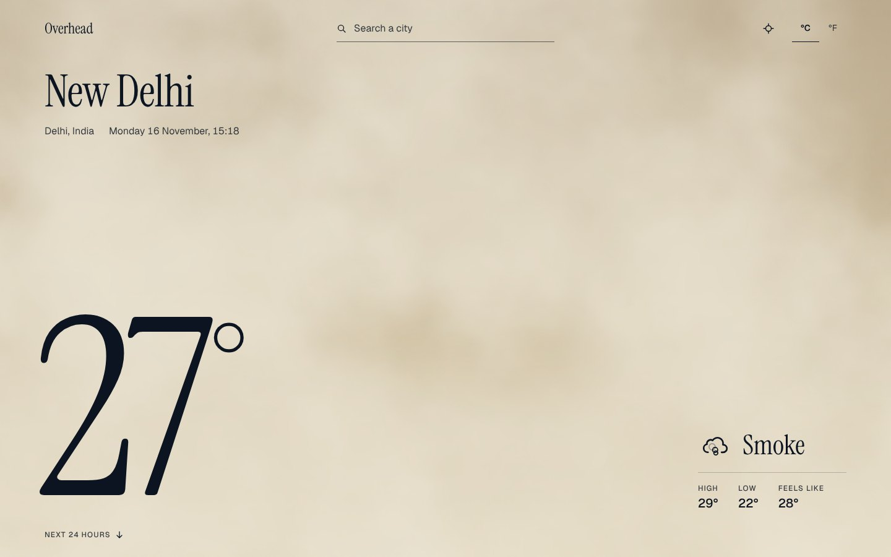
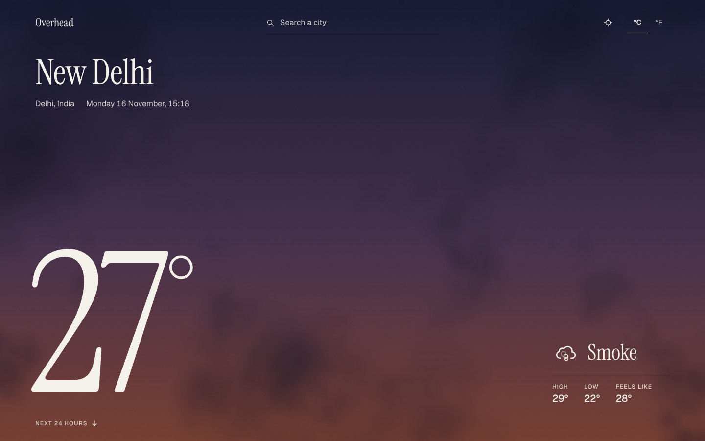
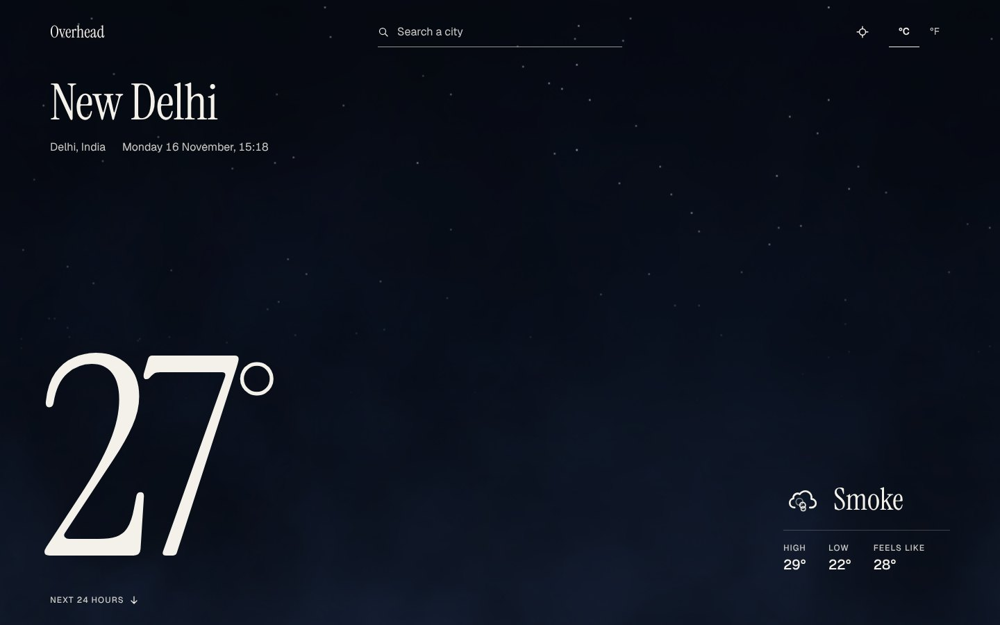
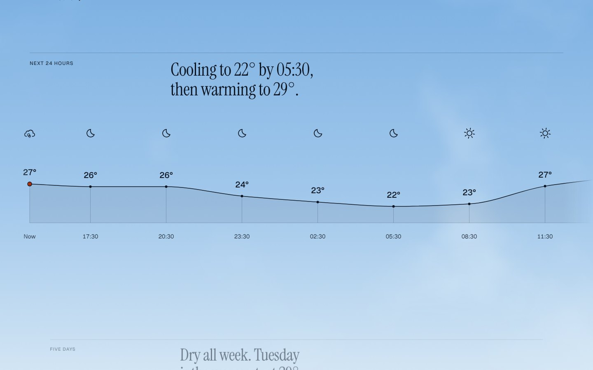
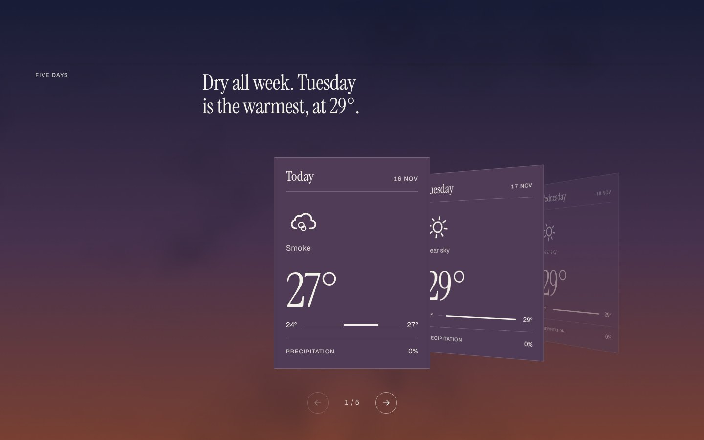

# Overhead

A weather report that looks like the sky it describes. Search any city and the whole page takes on that city's current sky: its colour, its cloud cover, its rain or smoke, and the time of day there.

**Live:** https://pranav-weather.netlify.app



| Dusk | Night |
| --- | --- |
|  |  |

| Next 24 hours | Five days |
| --- | --- |
|  |  |

## What it does

- **Now:** temperature, condition, high and low, and the local time at the searched city.
- **Next 24 hours:** a draggable timeline with the temperature drawn as a smooth curve, and a one-sentence summary written from the data.
- **Five days:** forecast panels arranged in perspective; drag, swipe, click, or use the arrow keys.
- **Conditions:** air quality, UV index, wind with a compass, humidity, pressure, visibility, and an arc showing where the sun is between sunrise and sunset.
- Search with recent places remembered locally, "use my location", and a °C/°F switch that also converts wind, distance and pressure.

## Tech stack

| | |
| --- | --- |
| App | React 19, TypeScript (strict), Vite |
| Sky | three.js with hand-written GLSL shaders |
| Motion | GSAP ScrollTrigger, Lenis |
| Type | Instrument Serif, Geist (self-hosted) |
| Icons | [Meteocons](https://github.com/basmilius/weather-icons) by Bas Milius |
| Data | OpenWeatherMap (weather, forecast, air quality, geocoding), Open-Meteo (UV index) |
| Hosting | Netlify, with a Netlify Function as the API proxy |
| Tests | Vitest |

## Design decisions

**The sky is the design system.** One small state, a condition (clear, clouds, rain, snow, haze, storm) and a phase of day (dawn, day, dusk, night), produces everything visual: the gradient, the text colour, the accent, and the 3D scene. There are no hard-coded colours in the components. See [`src/lib/sky.ts`](src/lib/sky.ts).

**Contrast is tested, not eyeballed.** All 24 skies are checked by a unit test for WCAG AA (4.5:1) on primary and secondary text against every gradient stop. Clouds are always paler than a light sky and darker than a dark one, so a cloud drifting behind text can only improve contrast. See [`src/lib/sky.test.ts`](src/lib/sky.test.ts).

**Typography carries the hierarchy.** One serif for figures and headlines, one grotesk for labels and data, a fixed type scale, and an 8px spacing grid. Numbers use tabular figures so they don't shift as they update. Section headlines are sentences generated from the forecast ("Cooling to 22° by 05:30, then warming to 29°.") rather than generic titles.

**Scroll is the camera.** As the page scrolls, the WebGL camera moves forward through layers of cloud, and each section arrives from slightly further away. The motion is scrubbed to the scroll position, so nothing moves unless the reader does.

**The temperature curve cannot lie.** It uses monotone cubic interpolation, which never overshoots, so the line never shows a temperature above or below a real reading. The free forecast tier is three-hourly, and the axis is labelled that way instead of inventing hourly points. See [`src/lib/curve.ts`](src/lib/curve.ts).

**The 3D layer is optional by construction.** A CSS gradient with the same colour stops paints on the first frame. three.js loads in its own chunk once the browser is idle and fades in over it. The scene is skipped entirely for `prefers-reduced-motion`, when WebGL is unavailable or software-rendered, and when measured frame times are too slow. Phones and low-core devices get fewer layers and particles at a lower resolution.

**Rows, not cards.** Conditions are set as a ruled specification sheet, each row with a plain-language note ("Reduced by smoke", "2° warmer than the air"). Only the forecast uses panels, because there the panels are the interaction.

## Architecture

```
netlify/functions/weather.ts   GET /api/weather: the only endpoint the browser calls for weather
server/                        provider fetchers and the pure normaliser (unit tested)
src/
  types/weather.ts             the contract between the function and the client
  services/weatherApi.ts       every network call the client makes
  hooks/                       useWeather (loading, errors, cancellation, stale refresh),
                               recent searches, units, geolocation, sky theme, scroll motion
  lib/                         pure logic: sky palettes, units, time, curve, summaries
  components/                  TopBar, Hero, Hourly, Forecast, Details, Footer, Sky, Status
  styles/                      design tokens and global styles
```

**The API key never reaches the browser.** The client calls `/api/weather`; the Netlify Function reads `OPENWEATHER_API_KEY` from the environment, calls four OpenWeatherMap endpoints, and returns one typed, normalised report. The UV index comes from Open-Meteo, which needs no key, so the client requests it directly.

**Failure is designed.** An unknown city or a failed request keeps the current report on screen and explains what happened. A first load with no data shows a full error state with a retry. Denied geolocation explains how to proceed. Air quality and UV are optional: if either request fails, that row says so and the rest of the page is unaffected.

## Run it locally

Requires Node 22 or newer.

```bash
git clone https://github.com/Krishnaaa3004/weather-app.git
cd weather-app
npm install
cp .env.example .env
```

Add a free [OpenWeatherMap API key](https://home.openweathermap.org/api_keys) to `.env`:

```
OPENWEATHER_API_KEY=your_key_here
```

```bash
npm run dev
```

The dev server runs the Netlify Function itself, so no Netlify CLI is needed.

| Command | |
| --- | --- |
| `npm run dev` | Start the dev server |
| `npm run build` | Typecheck and build to `dist/` |
| `npm test` | Run the unit tests |
| `npm run typecheck` | Typecheck only |

To preview any sky without waiting for the weather, add `?sky=<condition>-<phase>` to the URL, for example `?sky=storm-dusk`.

## Deploying

The repository is connected to Netlify, and [`netlify.toml`](netlify.toml) sets the build command, publish directory and functions directory. The only manual step is the environment variable:

**Site configuration → Environment variables → add `OPENWEATHER_API_KEY`**, available to all deploy contexts so deploy previews work too.

## Credits

Weather, forecast and air quality data from [OpenWeatherMap](https://openweathermap.org/). UV index from [Open-Meteo](https://open-meteo.com/). Icons are [Meteocons](https://github.com/basmilius/weather-icons) by Bas Milius (MIT), recoloured to follow the sky.
